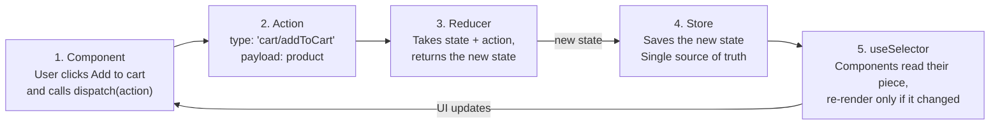

# Introduction to Redux in React

[← Day 4 overview](README.md)

1. [What is Redux?](#1-what-is-redux)
2. [How Redux works](#2-how-redux-works)
3. [Setup](#3-setup)
4. [Practical 1: Counter](#4-practical-1-counter)
5. [Practical 2: Shopping cart](#5-practical-2-shopping-cart)
6. [Fetching data with createAsyncThunk](#6-fetching-data-with-createasyncthunk)
7. [Practical 3: Products from an API](#7-practical-3-products-from-an-api)
8. [Redux vs useReducer vs useContext](#8-redux-vs-usereducer-vs-usecontext)
9. [When something breaks](#9-when-something-breaks)

## 1. What is Redux?

Redux is a library for managing **shared state**: data that many components need, like the logged-in user or a shopping cart. Instead of each component keeping its own copy, Redux keeps that data in one central place called the **store**. Any component can read from the store, and any component can ask for a change.

Redux isn't part of React. It's a separate library, and we connect it to React with a second package called `react-redux`.

### The problem it solves

Here's a shop app without Redux. The cart count lives in `App`, but only `CartBadge` uses it:

```jsx
function App() {
  const [cartCount, setCartCount] = useState(0)
  return <Header cartCount={cartCount} />
}

function Header({ cartCount }) {
  return <Navbar cartCount={cartCount} /> // doesn't use it, just passes it on
}

function Navbar({ cartCount }) {
  return <CartBadge cartCount={cartCount} /> // doesn't use it either
}

function CartBadge({ cartCount }) {
  return <span>Cart ({cartCount})</span> // the only one that needs it
}
```

`Header` and `Navbar` have to accept `cartCount` and pass it on, even though they never use it. This is called **prop drilling**. It causes three problems:

- Components carry data they don't care about, which makes them harder to read.
- Renaming or changing the data means editing every component in the chain.
- When a checkout page or a mini-cart also needs the count, the chains multiply.

With Redux, the cart lives in the store. `CartBadge` asks the store for the count directly, and `Header` and `Navbar` don't need to know the cart exists.

### Analogy: M-Pesa

- Your balance is kept in one place, Safaricom's system. That's the **store**.
- You can't edit your balance yourself. You send a request: "Send KES 500 to Achieng". That's an **action**.
- Safaricom applies fixed rules: check the balance, deduct, credit. That's a **reducer**.
- You get an SMS and the app shows your new balance. That's your **components updating**.
- Your statement lists every transaction in order. That's **Redux DevTools**.

Each of these terms is explained properly in the next section.

## 2. How Redux works

Redux has one main rule: **components never change the store directly.** They send a message describing what happened, and Redux works out the new state. Every change goes around the same loop:



Walk through the loop using "add to cart" as the example:

1. **Component.** The user clicks *Add to cart*. The component calls `dispatch` and hands it an action.
2. **Action.** The action is a plain object describing what happened: `{ type: 'cart/addToCart', payload: product }`. `type` is the name of the event. `payload` is the data that goes with it, here the product that was clicked.
3. **Reducer.** Redux gives the reducer two things: the current state and the action. The reducer reads the action and returns the new state, which is the cart with the product added.
4. **Store.** The store saves the new state.
5. **useSelector.** Every component reading cart data gets the new value and re-renders. The badge now shows 1.

Why work this way? Because every change is an action, you get a complete record of everything that happened. When something breaks, you can look at that list and find the action that caused it.

### The key terms

| Term | What it means | Example |
|---|---|---|
| Store | The one place shared data lives | `configureStore(...)` |
| Action | A plain object that says what happened | `{ type: 'cart/addToCart', payload: product }` |
| Dispatch | The function that sends an action to the store | `dispatch(addToCart(product))` |
| Reducer | A function that takes the current state and an action, and returns the new state | The `addToCart` function |
| Selector | A function that reads one piece of data from the store | `useSelector((state) => state.cart.items)` |
| Slice | One feature's data and reducers, kept together in one file | `cartSlice` |

### Reducers must be pure

A pure function always gives the same output for the same input, and doesn't touch anything outside itself.

```js
// Pure: same input, same output, every time
const add = (a, b) => a + b

// Not pure: a different result every time
const roll = () => Math.random()

// Not pure: talks to the outside world and takes time
const load = async () => await fetch('/api/products')
```

Reducers must be pure so Redux always knows exactly what an action will do. That's why API calls never go inside a reducer. [Section 6](#6-fetching-data-with-createasyncthunk) shows where they go instead.

### Redux Toolkit

Plain Redux needs a lot of repetitive code. **Redux Toolkit (RTK)** is the official package that cuts it down, and it's how Redux is written today. With RTK you mostly write one thing per feature: a **slice**. If you find a tutorial using `createStore` or a `switch` on `action.type`, it's showing the old way.

## 3. Setup

Connecting Redux to React takes three files:

1. **A slice:** one feature's data, plus the rules for changing it.
2. **The store:** holds all the slices together.
3. **The Provider:** makes the store available to every component.

You also need the Redux DevTools browser extension installed (Chrome, Edge or Firefox).

### Create the project

```bash
npm create vite@latest duka -- --template react
cd duka
npm install
npm install @reduxjs/toolkit react-redux
npm run dev
```

The last install adds two packages:

- `@reduxjs/toolkit` is Redux itself, plus the helpers that make it easier, like `createSlice` and `configureStore`.
- `react-redux` connects Redux to React. It gives us `<Provider>`, `useSelector` and `useDispatch`.

Delete the starter content in `src/App.jsx` so it just returns `<h1>Duka</h1>`.

We'll organise files by feature. Each feature gets a folder holding its slice and its components:

```text
src/
├── app/
│   └── store.js            <- the store
├── features/
│   └── counter/
│       ├── counterSlice.js <- the counter's data and rules
│       └── Counter.jsx     <- the counter's component
├── App.jsx
└── main.jsx
```

Later we add `cart/` and `products/` folders next to `counter/`.

### File 1: the slice

```js
// src/features/counter/counterSlice.js
import { createSlice } from '@reduxjs/toolkit'

const counterSlice = createSlice({
  name: 'counter',
  initialState: { value: 0 },
  reducers: {
    increment(state) {
      state.value += 1
    },
    decrement(state) {
      state.value -= 1
    },
    reset(state) {
      state.value = 0
    },
  },
})

export const { increment, decrement, reset } = counterSlice.actions
export default counterSlice.reducer
```

What each part does:

- `createSlice` builds a slice from three things:
  - `name` is a label for the slice. It becomes the first half of every action type, so the actions are called `counter/increment`, `counter/decrement` and `counter/reset`.
  - `initialState` is the data the slice starts with. Our counter starts at `{ value: 0 }`.
  - `reducers` holds one function per change. Each function receives the current state and updates it.
- `counterSlice.actions` holds an action creator for each reducer, made for us by RTK. Calling `increment()` returns the action object `{ type: 'counter/increment' }`, so we never write action objects by hand. We export them so components can use them.
- `counterSlice.reducer` combines all the reducer functions into one. The store needs this, so it's the default export.

> [!NOTE]
> **About `state.value += 1`.** In React you normally must never change state directly. You make a new copy instead. Inside `createSlice`, RTK uses a library called Immer, which lets you write simple "change it" code and makes the safe copy for you behind the scenes. This only works inside slices. In components, the rule still applies: never change state directly.

### File 2: the store

```js
// src/app/store.js
import { configureStore } from '@reduxjs/toolkit'
import counterReducer from '../features/counter/counterSlice'

export const store = configureStore({
  reducer: {
    counter: counterReducer,
  },
})
```

What it does:

- `configureStore` creates the store. It also switches on Redux DevTools and adds helpful warnings, with no extra setup.
- `reducer: { counter: counterReducer }` plugs our slice into the store under the name `counter`. That name decides where the data lives: `state.counter.value`. When we add a cart slice later as `cart`, its data will live at `state.cart`.

### File 3: the Provider

```jsx
// src/main.jsx
import { StrictMode } from 'react'
import { createRoot } from 'react-dom/client'
import { Provider } from 'react-redux'
import { store } from './app/store'
import App from './App'
import './index.css'

createRoot(document.getElementById('root')).render(
  <StrictMode>
    <Provider store={store}>
      <App />
    </Provider>
  </StrictMode>
)
```

What it does:

- `<Provider store={store}>` wraps the whole app, so every component inside it can reach the store.
- Without it, `useSelector` and `useDispatch` don't work and React shows an error.
- The only new lines are the two imports and the `<Provider>` wrapper. Everything else is what Vite already gave us.

### Check it works

Open the browser DevTools, go to the **Redux** tab, then **State**. You should see `{ counter: { value: 0 } }`. That's the store, holding the counter's starting value.

To see what an action looks like, add `console.log(increment())` at the bottom of `counterSlice.js` and check the browser console. It prints `{ type: 'counter/increment', payload: undefined }`. An action really is just a plain object. Remove the line afterwards.

## 4. Practical 1: Counter

Build a counter that reads its number from the store and changes it with buttons. Code along as you read.

### The Counter component

```jsx
// src/features/counter/Counter.jsx
import { useSelector, useDispatch } from 'react-redux'
import { increment, decrement, reset } from './counterSlice'

export default function Counter() {
  const count = useSelector((state) => state.counter.value)
  const dispatch = useDispatch()

  return (
    <div>
      <h2>{count}</h2>
      <button onClick={() => dispatch(decrement())}>-</button>
      <button onClick={() => dispatch(increment())}>+</button>
      <button onClick={() => dispatch(reset())}>Reset</button>
    </div>
  )
}
```

What each line does:

- `useSelector((state) => state.counter.value)` reads from the store. You give `useSelector` a function, Redux calls it with the whole store state, and you return the piece you need, here the counter's value. Whenever that value changes, the component re-renders with the new number.
- `const dispatch = useDispatch()` gives you the `dispatch` function. It's the only way to send an action to the store.
- `onClick={() => dispatch(increment())}` happens in two steps. `increment()` creates the action object, then `dispatch(...)` sends it to the store. The store runs the `increment` reducer, the value goes up by 1, and `useSelector` picks up the new value.

### Show it on the page

Render the counter twice:

```jsx
// src/App.jsx
import Counter from './features/counter/Counter'

export default function App() {
  return (
    <>
      <h1>Duka</h1>
      <Counter />
      <Counter />
    </>
  )
}
```

Click **+** on either counter and both change. They don't share props or a parent's state. Both are reading the same value from the store. This is the main thing Redux gives you: any component can read and update shared data without passing props around.

### Look at it in Redux DevTools

Click the buttons a few times, then open the browser DevTools and go to the **Redux** tab:

- The list on the left shows every action in order. Each click adds one, like `counter/increment`.
- **Action** tab shows the selected action's `type` and `payload`.
- **State** tab shows the whole store after that action.
- **Diff** tab shows only what changed, like `value: 2 → 3`.
- The slider at the bottom lets you drag back in time and watch the page return to an earlier state.

## 5. Practical 2: Shopping cart

Now a real use for Redux: a cart. The header shows how many items are in the cart, and a cart section lists them. They're two separate components using the same data.

Try writing `removeFromCart` and `clearCart` yourself before you read the full slice below.

### Step 1: The cart slice

```js
// src/features/cart/cartSlice.js
import { createSlice } from '@reduxjs/toolkit'

const cartSlice = createSlice({
  name: 'cart',
  initialState: { items: [] },
  reducers: {
    addToCart(state, action) {
      const product = action.payload
      const existing = state.items.find((item) => item.id === product.id)
      if (existing) {
        existing.quantity += 1
      } else {
        state.items.push({ ...product, quantity: 1 })
      }
    },
    removeFromCart(state, action) {
      state.items = state.items.filter((item) => item.id !== action.payload)
    },
    clearCart(state) {
      state.items = []
    },
  },
})

export const { addToCart, removeFromCart, clearCart } = cartSlice.actions
export default cartSlice.reducer
```

What each part does:

- The state starts as `{ items: [] }`, an empty cart. Each item added will look like `{ id, title, price, quantity }`.
- `addToCart` receives the clicked product as `action.payload`. `find` checks whether that product is already in the cart. If it is, its `quantity` goes up by 1. If it isn't, `push` adds it with `quantity: 1`. The `...product` copies the product's fields (`id`, `title`, `price`) into the new item.
- `removeFromCart` receives an `id` as `action.payload`. `filter` keeps every item except the one with that id.
- `clearCart` replaces the list with an empty array.
- Because the slice is named `cart`, the actions are called `cart/addToCart`, `cart/removeFromCart` and `cart/clearCart`. You'll see these names in DevTools.

### Step 2: Add it to the store

```js
// src/app/store.js
import { configureStore } from '@reduxjs/toolkit'
import counterReducer from '../features/counter/counterSlice'
import cartReducer from '../features/cart/cartSlice'

export const store = configureStore({
  reducer: {
    counter: counterReducer,
    cart: cartReducer,
  },
})
```

The store now holds two slices. The cart's data lives at `state.cart.items`. Each slice looks after its own data, so the counter and the cart don't affect each other.

### Step 3: The product list

```jsx
// src/features/products/ProductList.jsx
import { useDispatch } from 'react-redux'
import { addToCart } from '../cart/cartSlice'

const products = [
  { id: 1, title: 'Kikoy', price: 1200 },
  { id: 2, title: 'Kiondo basket', price: 2500 },
  { id: 3, title: 'Maasai shuka', price: 1800 },
]

export default function ProductList() {
  const dispatch = useDispatch()

  return (
    <div>
      <h2>Products</h2>
      {products.map((product) => (
        <div key={product.id}>
          {product.title} - KES {product.price}
          <button onClick={() => dispatch(addToCart(product))}>Add to cart</button>
        </div>
      ))}
    </div>
  )
}
```

The products are hardcoded for now. Practical 3 loads them from an API instead. Clicking **Add to cart** dispatches `addToCart(product)`. The whole product object becomes the payload, which is what the reducer reads as `action.payload`.

### Step 4: The cart count

```jsx
// src/features/cart/CartIcon.jsx
import { useSelector } from 'react-redux'

export default function CartIcon() {
  const count = useSelector((state) =>
    state.cart.items.reduce((sum, item) => sum + item.quantity, 0)
  )

  return <p>Cart: {count}</p>
}
```

The selector goes through every item and adds up the quantities, starting from 0. Two kikoys and one basket gives a count of 3. We don't store the count anywhere. We calculate it from the items, so it can never be wrong.

### Step 5: The cart

```jsx
// src/features/cart/Cart.jsx
import { useSelector, useDispatch } from 'react-redux'
import { removeFromCart, clearCart } from './cartSlice'

export default function Cart() {
  const items = useSelector((state) => state.cart.items)
  const dispatch = useDispatch()
  const total = items.reduce((sum, item) => sum + item.price * item.quantity, 0)

  if (items.length === 0) return <p>Your cart is empty.</p>

  return (
    <div>
      <h2>Cart</h2>
      {items.map((item) => (
        <div key={item.id}>
          {item.title} x {item.quantity}
          <button onClick={() => dispatch(removeFromCart(item.id))}>Remove</button>
        </div>
      ))}
      <p>Total: KES {total}</p>
      <button onClick={() => dispatch(clearCart())}>Clear cart</button>
    </div>
  )
}
```

What it does:

- `useSelector((state) => state.cart.items)` reads the list of items.
- `total` multiplies each item's price by its quantity and adds them up. Like the count, it's calculated, not stored.
- If the cart is empty, the component shows a message instead of an empty list.
- **Remove** dispatches `removeFromCart(item.id)`. The reducer only needs the id to know which item to remove, so that's all we send.
- **Clear cart** dispatches `clearCart()`, which needs no payload.

### Step 6: Put it together

```jsx
// src/App.jsx
import CartIcon from './features/cart/CartIcon'
import Cart from './features/cart/Cart'
import ProductList from './features/products/ProductList'

export default function App() {
  return (
    <>
      <h1>Duka</h1>
      <CartIcon />
      <ProductList />
      <Cart />
    </>
  )
}
```

Test it:

- Add the same product twice. The cart shows `x 2` and the count shows 2.
- Remove it. The count and total update straight away.
- Clear the cart. The empty message appears.

Once it works, notice two things:

- `CartIcon` and `Cart` aren't connected by props, yet they always agree, because both read from the store.
- The count and total aren't stored anywhere. They're calculated from `items`. The rule: **store the raw data, calculate the rest.**

## 6. Fetching data with createAsyncThunk

So far every change has been instant: click, update, done. Loading data from an API is different. It takes time, and it can fail. Reducers can't handle this, because they must be pure ([section 2](#reducers-must-be-pure)). Redux Toolkit gives us `createAsyncThunk` for it.

A **thunk** is a function that does some async work, like a fetch, then dispatches actions with the result. `createAsyncThunk` builds one for us.

### The three actions

When you dispatch a thunk made with `createAsyncThunk`, it sends up to three actions over its lifetime:

1. **`pending`** is sent straight away. The request has started, so we show "Loading...".
2. **`fulfilled`** is sent when the data arrives. The data is in `action.payload`.
3. **`rejected`** is sent if something fails. The error message is in `action.error.message`.

Only one of `fulfilled` or `rejected` happens, never both. The slice listens for these three actions and updates its state for each one.

### The products slice

```js
// src/features/products/productsSlice.js
import { createSlice, createAsyncThunk } from '@reduxjs/toolkit'

export const fetchProducts = createAsyncThunk('products/fetchProducts', async () => {
  const res = await fetch('https://fakestoreapi.com/products')
  if (!res.ok) throw new Error('Could not load products')
  return res.json()
})

const productsSlice = createSlice({
  name: 'products',
  initialState: { items: [], status: 'idle', error: null },
  reducers: {},
  extraReducers: (builder) => {
    builder
      .addCase(fetchProducts.pending, (state) => {
        state.status = 'loading'
      })
      .addCase(fetchProducts.fulfilled, (state, action) => {
        state.status = 'succeeded'
        state.items = action.payload
      })
      .addCase(fetchProducts.rejected, (state, action) => {
        state.status = 'failed'
        state.error = action.error.message
      })
  },
})

export default productsSlice.reducer
```

**The thunk (`fetchProducts`)**

- The first argument, `'products/fetchProducts'`, is the action name. RTK adds `/pending`, `/fulfilled` or `/rejected` to the end.
- The second argument is the async function that does the work. Whatever it returns becomes `action.payload` in `fulfilled`. If it throws, `rejected` is sent instead.
- `if (!res.ok) throw ...` matters. `fetch` only fails by itself when there's no network at all. A 404 or 500 still counts as a response, so we throw ourselves to make sure `rejected` runs.

**The slice**

- `initialState` has three fields: `items` holds the products, `status` says where the request is, and `error` holds the message if it fails.
- `status` can be `'idle'` (not started), `'loading'` (waiting), `'succeeded'` (data arrived) or `'failed'` (something went wrong). The component uses it to decide what to show.
- `reducers: {}` is empty because this slice has no actions of its own. All its changes come from the thunk.
- `extraReducers` is where a slice responds to actions created somewhere else, like the thunk's three. `builder.addCase(fetchProducts.pending, ...)` means "when the pending action happens, run this function".

## 7. Practical 3: Products from an API

Replace the hardcoded products with real ones from the [Fake Store API](https://fakestoreapi.com). It's free, needs no sign-up, and returns 20 products, each with an `id`, `title`, `price`, `category`, `description` and `image`.

### Step 1: Add the slice to the store

```js
// src/app/store.js
import { configureStore } from '@reduxjs/toolkit'
import counterReducer from '../features/counter/counterSlice'
import cartReducer from '../features/cart/cartSlice'
import productsReducer from '../features/products/productsSlice'

export const store = configureStore({
  reducer: {
    counter: counterReducer,
    cart: cartReducer,
    products: productsReducer,
  },
})
```

The products data now lives at `state.products`.

### Step 2: Update the product list

```jsx
// src/features/products/ProductList.jsx
import { useEffect } from 'react'
import { useDispatch, useSelector } from 'react-redux'
import { fetchProducts } from './productsSlice'
import { addToCart } from '../cart/cartSlice'

export default function ProductList() {
  const dispatch = useDispatch()
  const products = useSelector((state) => state.products.items)
  const status = useSelector((state) => state.products.status)
  const error = useSelector((state) => state.products.error)

  useEffect(() => {
    if (status === 'idle') {
      dispatch(fetchProducts())
    }
  }, [status, dispatch])

  if (status === 'loading') return <p>Loading products...</p>
  if (status === 'failed') return <p>Error: {error}</p>

  return (
    <div>
      <h2>Products</h2>
      {products.map((product) => (
        <div key={product.id}>
          {product.title} - ${product.price}
          <button onClick={() => dispatch(addToCart(product))}>Add to cart</button>
        </div>
      ))}
    </div>
  )
}
```

What changed from Practical 2:

- The hardcoded `products` array is gone. The products now come from the store with `useSelector`.
- We also read `status` and `error`, so we know whether to show the list, a loading message or an error.
- `useEffect` starts the fetch when the component first appears.
- `if (status === 'idle')` makes sure we only fetch once. After the first dispatch, the status changes to `'loading'`, so the effect won't fetch again.
- The two `if` lines before the `return` show a loading message or an error instead of the list.
- The **Add to cart** button is the same as before. The cart doesn't care where products come from.

The API's prices are in US dollars, so change `KES` to `$` in `Cart.jsx` too.

### What happens when the page loads

With DevTools open, this is the order things happen in:

1. `ProductList` appears. The status is `'idle'`.
2. `useEffect` sees `'idle'` and dispatches `fetchProducts()`.
3. `products/fetchProducts/pending` is sent. The status becomes `'loading'`, and the page shows "Loading products...".
4. The data arrives. `products/fetchProducts/fulfilled` is sent, the products are saved in `items`, and the status becomes `'succeeded'`.
5. The component re-renders and shows the list.

If the request fails at step 4, `rejected` is sent instead, the status becomes `'failed'`, and the error message shows.

### Break it on purpose

Change the URL in the thunk to `https://fakestoreapi.com/productz` and reload. You'll see the `rejected` action in DevTools and the error message on the page. This shows the error handling works. Then change it back.

> [!TIP]
> If you notice the request runs twice in the browser's Network tab: that's React's `StrictMode`, which runs effects twice in development to catch bugs. It doesn't happen in the live app.

## 8. Redux vs useReducer vs useContext

All three share the same idea of sending an action and getting new state back. The difference is where the state lives and who can reach it.

**useReducer** works like Redux, but inside one component. You write a reducer and dispatch actions, but the state belongs to that component. Other components only see it if you pass it down as props.

**useContext** doesn't manage state at all. It's a way to pass a value down the component tree without prop drilling. It doesn't care how that value changes. Every component using the context re-renders whenever the value changes.

**Redux** keeps state in a store outside your components. Any component can read just the piece it needs, and it only re-renders when that piece changes. It also comes with DevTools and tools for fetching data.

| Tool | Where the state lives | Use it for |
|---|---|---|
| `useReducer` | Inside one component | Complex state only one component needs, like a multi-step form |
| `useContext` | Wherever you put it. Context only delivers it | A few values that rarely change, like the theme or the logged-in user |
| Redux | In a store outside the components | Lots of shared data that changes often, like a cart or filters |

A simple way to put it: **useReducer is Redux for one component, Context is the delivery system, and Redux is both with better tools.**

**Do you always need Redux?** No. For a small app, `useReducer` with Context is often enough. Redux pays off when many components share data that changes often, or when a team needs to trace every change. It's also worth knowing because many companies' React codebases use it.

## 9. When something breaks

These are the errors you're most likely to hit, why they happen, and how to fix them.

| What happens | Why | Fix |
|---|---|---|
| Error: `could not find react-redux context value` | The component can't find the store | Wrap `<App />` in `<Provider store={store}>` in `main.jsx` |
| Clicking does nothing, and no action shows in DevTools | `dispatch(increment)` was written without brackets, so no action was created | Use `dispatch(increment())` |
| Data shows as `undefined` | The selector is reading the wrong path | Match the name in `configureStore`: if the slice is added as `counter`, read `state.counter.value` |
| Redux tab says no store found | DevTools can't see a store | Install the extension, and check the `Provider` is in place |
| Products never load and no error shows | The fetch never started | Check the products slice is in the store, and that `useEffect` dispatches `fetchProducts()` |

### A checklist for any Redux bug

Work through it in this order:

1. **Did the action fire?** Look for it in the DevTools action list. If it's missing, the problem is the button or the `dispatch` call.
2. **Did the state change?** Click the action and check the **Diff** tab. If nothing changed, the problem is in the reducer.
3. **State is right but the page is wrong?** The problem is in the component or the selector.
